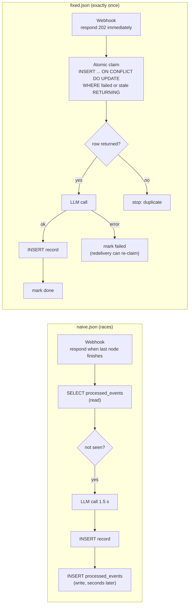

# n8n webhook dedupe demo (duplicate events, measured and fixed)

Author: Northkeel Labs (northkeellabs.com)

A small, reproducible demo of the most common n8n production bug: the same webhook event arrives more than once, the workflow runs again, the AI step is paid for twice and the destination table gets duplicate rows. The repo runs three versions of the same workflow under the same load and measures each one:

1. **naive**: responds when the last node finishes and checks "have I seen this event?" with a SELECT before processing. This is a read-then-write check, and it races.
2. **builtin**: n8n's own Remove Duplicates node ("Remove Items Processed in Previous Executions", deduped on the event id).
3. **fixed**: responds 202 immediately, then claims the event with one atomic Postgres statement, so each event is processed exactly once.

Everything runs locally in Docker (n8n 2.47.5, Postgres 16, a mock OpenAI-compatible LLM). No paid key is needed. All events, companies and amounts are fictional.

## Results: fixed is exactly once in every run

Self-run on a local Docker stack on 2026-11-12 (Windows 11, Docker Desktop); numbers vary by machine. Harness defaults: 20 unique fictional events, each delivered 5 times at the same instant, events started 0.2 s apart (see The harness below), client timeout 1 s, up to 2 retries on timeout, mock LLM latency 1.5 s. Three runs per workflow; every run is shown.

| Workflow | Run | Unique events | HTTP deliveries | LLM calls | Records | Duplicate records |
|---|---|---|---|---|---|---|
| naive | 1 | 20 | 299 | 109 | 109 | 89 |
| naive | 2 | 20 | 296 | 106 | 106 | 86 |
| naive | 3 | 20 | 296 | 106 | 106 | 86 |
| builtin (Remove Duplicates) | 1 | 20 | 150 | 50 | 50 | 30 |
| builtin (Remove Duplicates) | 2 | 20 | 131 | 31 | 31 | 11 |
| builtin (Remove Duplicates) | 3 | 20 | 129 | 29 | 29 | 9 |
| **fixed** | 1 | 20 | 100 | **20** | **20** | **0** |
| **fixed** | 2 | 20 | 100 | **20** | **20** | **0** |
| **fixed** | 3 | 20 | 100 | **20** | **20** | **0** |

Min / max over the three runs: naive 106 - 109 LLM calls for 20 events (5.3x - 5.5x the necessary AI spend); builtin 29 - 50 (1.45x - 2.5x); fixed 20 every time. No event was lost by any workflow. Full tables in `results/latest.md` and `results/latest.json`.

What the numbers say:

- **naive**: its SELECT-then-INSERT check lets the 5 burst copies through together, and because it answers only after the 1.5 s LLM call, the provider times out (1 s) and retries, so the HTTP deliveries roughly triple.
- **builtin**: n8n's Remove Duplicates node stops most burst copies, but not all, and the leak varies from run to run. In n8n 2.47.5 the node reads the whole dedupe history (one JSON array per workflow), checks and appends in memory, and writes the array back with no lock, so concurrent executions can both pass and can overwrite each other's writes. `results/builtin-history-check.txt` shows a run where 20 new events were recorded but the stored history grew by only 19. It also answers only at the end, so timeout retries still happen. With no overlapping executions (diagnostic runs with burst only, or retries only) it removed every duplicate; it is not race-safe under concurrent deliveries.
- **fixed**: every delivery gets its 202 well inside the 1 s timeout (no retries), and the atomic claim lets exactly one copy through: one LLM call and one record per event.

Extra stress run, all 100 deliveries sent at the same instant (`results/all-at-once.md`, one run): naive 100 LLM calls, builtin 282, fixed 20. At that rate n8n queued requests past the 1 s timeout for every workflow, so all three were retried, and fixed still processed each event exactly once.

Tests: 31 unit tests and 4 integration tests pass (`results/test-output-unit.txt`, `results/test-output-stack.txt`), including the fault test: the first LLM call for an event fails, the event is marked failed, a redelivery processes it exactly once (one successful LLM call, one record), and a further redelivery does nothing.

## IMPORTANT: the LLM is mocked

The "AI call" goes to a tiny local mock of the OpenAI chat completions API (`mock_llm/server.py`, Python stdlib). It waits 1.5 s (a realistic LLM latency) and returns canned text. It counts calls per event id, which is how the harness measures wasted AI calls, and it can fail the first call for a chosen event (fault injection). n8n, Postgres, the workflows, the webhooks, the retries and the races are all real; only the model's answer is fake. To call a real OpenAI-compatible endpoint instead, set `OPENAI_BASE_URL`, `OPENAI_API_KEY` and `OPENAI_MODEL` in `.env` (for local Ollama: `http://host.docker.internal:11434/v1`). That path is untested in this repo.

## Naive vs fixed



Naive: provider timeout (1 s) is shorter than the run (1.5 s LLM call), so the provider retries while the first run is still going; and the burst copies all pass the SELECT before any of them writes. Fixed: the provider gets its 202 in milliseconds (no timeout retries), and the primary key on `processed_events.event_key` lets exactly one concurrent delivery win the claim. Details in [ROOT_CAUSE.md](ROOT_CAUSE.md).

## Run it yourself (free, 3 commands)

Needs Docker Desktop (or Docker Engine with compose) and [uv](https://docs.astral.sh/uv/).

```
uv sync
uv run python scripts/demo.py setup      # .env with random secrets, compose up, import + publish the 3 workflows
uv run python scripts/demo.py run -- --runs 3
```

`setup` generates `.env` (secrets are never printed), starts the stack, imports the Postgres credential and the three workflows with the n8n CLI and publishes them, so there are no manual UI steps. `run` resets the tables and the mock before each run and writes `results/latest.json` and `results/latest.md`. `uv run python scripts/demo.py teardown` removes the containers and volumes.

Tests:

```
uv run pytest                 # unit tests (static workflow checks, harness counting, claim SQL against the live Postgres)
uv run pytest -m stack        # integration tests against the running stack
```

The n8n editor is at http://localhost:5678 (create the owner account on first visit) if you want to look at the workflows.

## The harness

`dedupe_demo/harness.py` (Python, async httpx) behaves like a webhook provider. For each workflow, after a reset:

- sends M=20 unique fictional events; each event is delivered K=5 times at the same instant (burst duplicates);
- client timeout 1 s per delivery, up to 2 retries when a delivery times out (provider-style retries);
- starts one event every 0.2 s (a provider streaming events); `--interval 0` sends all 100 deliveries at once;
- waits until LLM calls and rows stop changing, then counts: events sent, unique events, HTTP deliveries (incl. retries), mock LLM calls, records, duplicate records, missing events, wall time.

Why the 0.2 s spacing: on the test machine one n8n instance in regular mode handled roughly 26 webhook executions per second. Sending all 100 deliveries at the same instant queues them past the 1 s client timeout for every workflow, including the one that responds immediately. One all-at-once run per workflow is kept in `results/all-at-once.md` for reference.

## Apply the fix to your own workflow

1. Create the table in your Postgres (from `sql/init.sql`):
   ```sql
   CREATE TABLE IF NOT EXISTS processed_events (
       event_key  TEXT PRIMARY KEY,
       status     TEXT NOT NULL CHECK (status IN ('processing', 'done', 'failed')),
       attempts   INTEGER NOT NULL DEFAULT 1,
       claimed_at TIMESTAMPTZ NOT NULL DEFAULT now(),
       updated_at TIMESTAMPTZ NOT NULL DEFAULT now()
   );
   ```
2. Set your Webhook node to Respond: Immediately, with response code 202 (Options, Response Code, custom code 202).
3. Copy the nodes `Claim event`, `Claimed?`, `Mark done` and `Mark failed` from `workflows/fixed.json` (open the file, copy the JSON, paste into the n8n canvas) and point them at your Postgres credential.
4. Set the key expression in `Claim event`, Options, Query Parameters. The first value is your provider's event id, the second the body: `{{ $json.headers['x-event-id'] ?? '' }},{{ JSON.stringify($json.body ?? {}) }}`. Use the header your provider sends (for example Stripe puts `id` in the body: `{{ $json.body.id ?? '' }}`). With an empty first value the key is the sha256 of the canonical JSON body.
5. Put your slow or costly steps (LLM call, CRM insert) on the true branch of `Claimed?`, then `Mark done`. Wire their error outputs (Settings, On Error: Continue (using error output)) to `Mark failed`.

## Limits

- Queue mode with several workers: the same SQL holds. The claim is a single statement on a primary key, so Postgres serialises it no matter how many n8n workers or instances run it. (Not measured here; this demo runs n8n in regular mode.)
- Idempotency window: keys stay in `processed_events` until you delete them. Keep them at least as long as your provider retries (often 3 days); a nightly `DELETE ... WHERE status = 'done' AND updated_at < now() - interval '7 days'` is enough.
- A `processing` claim older than 5 minutes is treated as a crashed run and can be re-claimed. If a legitimate run can take longer, raise the interval.
- Responding 202 first means the provider will not retry your internal failures. `failed` rows are retried only when the event is redelivered; add a scheduled sweep for events that must not be lost.
- Destination-side unique constraint as a second guard: in production, also put a unique index on your destination key (here `records.event_key`). This demo leaves it off on purpose so duplicates are visible and countable.
- Side effects outside Postgres (emails, payments, third-party APIs) are covered only if you pass the same key as that API's idempotency key.
- Measured on one machine with Docker Desktop; absolute numbers (and how much the Remove Duplicates node leaks) depend on load and hardware.

## Optional: Redis SET NX instead of Postgres

If you already run Redis (n8n queue mode does), the claim can be `SET dedupe:<key> processing NX EX 300`: it succeeds for exactly one caller and expires after 5 minutes, which gives you the stale-claim rule for free. On success, set the key to `done` with a long TTL (the idempotency window); on failure, `DEL` it so a redelivery can claim it. Trade-offs: the state lives in memory (a Redis restart without persistence forgets keys), and you have no `attempts` or audit trail unless you add them. Postgres is the better default when the destination is already Postgres. Not implemented in this repo.

## Files

`docker-compose.yml`, `.env.example`, `sql/init.sql`, `mock_llm/server.py`, `workflows/` (naive.json, builtin.json, fixed.json), `dedupe_demo/` (harness, config, workflow SQL helper), `scripts/demo.py` (setup, run, teardown), `tests/`, `results/` (harness output and test output), [ROOT_CAUSE.md](ROOT_CAUSE.md), [SECURITY.md](SECURITY.md), `LICENSE` (MIT, covers our own files; n8n has its own licence).

## More from Northkeel Labs

Other demos and tools: [github.com/northkeellabs](https://github.com/northkeellabs).

## Disclaimer

Independent project, not affiliated with, endorsed by or sponsored by n8n GmbH. "n8n" is used only to name the software this demo runs on. The workflows, events and data are fictional and built for this demo; this is not a client's workflow.
